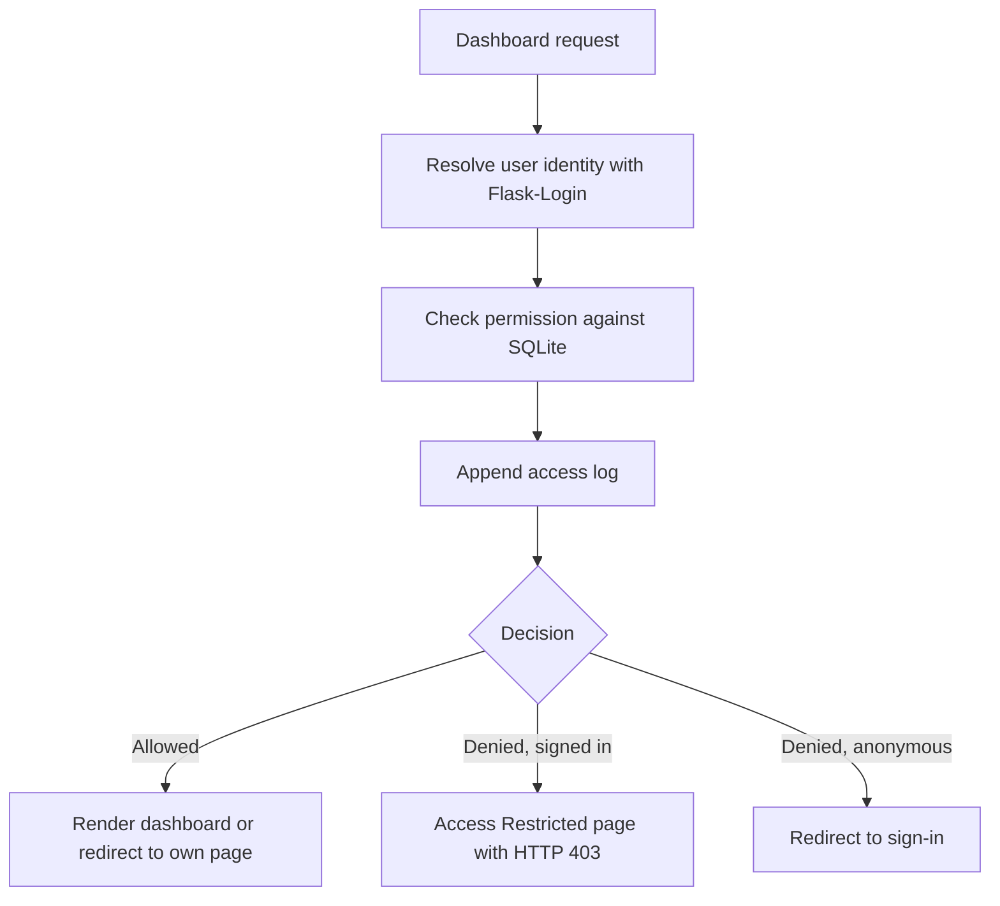

# Authorization architecture and workflow

Flask-Login resolves the session's user ID. Each dashboard or management route passes that
identity to `require_permission` with a policy action and target. The policy
queries the stored role and, for records, the owning student's ID and teacher
assignment. Authorization reads use the database transaction's view of the
rows. The audit module records the role resolved at the decision and signs the entry before the route returns a response.

## Using the policy from a route

| API | Purpose |
| --- | --- |
| `is_allowed(actor_id, action, ...)` | Evaluate a single permission without logging |
| `scoped_students(actor_id, action)` | Build a select for student accounts, including those without records |
| `scoped_records(actor_id, action)` | Build a SQLAlchemy select for view, edit or delete scope |
| `require_permission(action, ...)` | Evaluate and log the decision, then stop the request on denial |
| `stage_access_log(session, ...)` | Stage an audit row in the caller's transaction |

Use a constant from `Action` and derive the actor identity from Flask-Login.
Pass `student_id` for creation, `record_id` for view, edit or deletion, and
`dashboard_role` for a specific dashboard. The dispatcher uses the dashboard
action with no role target. Unrecognized actions and malformed targets are
denied. They cannot add unchecked values to audit labels.

For a record list, execute `scoped_records` as the data query and further filter
it as needed. It evaluates scope at query execution. For a single object, use
the corresponding guard before reading or changing the object. Authorization
answers whether the actor may perform the action. Model validation and database
constraints still handle input and invariants such as one record per Student.

## Transaction boundaries and limits

Call guards before staging business changes. Ordinary guards persist the audit
entry in a separate transaction, including denials. The audit entry records
authorization, so an allowed read can still fail later while rendering.
For create, edit and delete routes, pass `atomic=True` to the guard. An allowed
entry is then staged in the same session as the write. Commit both together, or
roll back both if validation or the database rejects the write. A denied write
still commits its audit row independently, before the response.

Phase 6 mutations that pass form validation use `BEGIN IMMEDIATE` before their
authorization and invariant checks. Phase 7 also rechecks the session's
credential binding inside this reservation, so a reset that committed first
blocks the mutation. SQLite holds the reservation through the record or account
change and audit commit. An atomic denial releases that
reservation before persisting its denial independently. The same reservation
serializes the last-Admin check. Invalid submissions and failed commits leave
no successful mutation audit row. Opening an authorized form can still add a
separate Allowed decision.

If a standalone audit insert fails, the request fails before it serves the
protected page. Standalone authorization and role capture run inside their own
SQLite writer reservation. For mutations, the decision, role snapshot and
journal append participate in the mutation transaction. Each append verifies
the local tail and advances the protected head in the same transaction.

Logged actor references restrict hard deletion. Old audit rows retain an
unknown role and are authenticated only from the migration baseline forward.
Server-tracked session ownership gates the Active sessions interface. See the
[security analysis](security-analysis.md#phase-71-advanced-hardening) for the
audit chain, rate limits and session architecture.

## Permission summary, filtered listings and audit export

Dashboards display role capabilities derived from the central record scope
and Admin resource rules. The panel describes role scope. Each request still
evaluates its particular student or record and requires a valid session.

Record and Teacher listings start from a policy-scoped Student query.
Search, sorting and availability filters narrow the query on the server.
Records awaiting creation have no stored course, so selecting a course only
matches Students with records. The Users list is Admin-only.

The CSV endpoint uses the existing Admin access-log guard and the same
filters and snapshot as the HTML list. It verifies audit integrity before
returning a report. It projects only the recorded event fields, formats time
in UTC and treats formula-like text as literal spreadsheet text. It exports
all matching events across pages. The CSV is a reporting format and does not
contain the HMAC links needed for journal verification.
