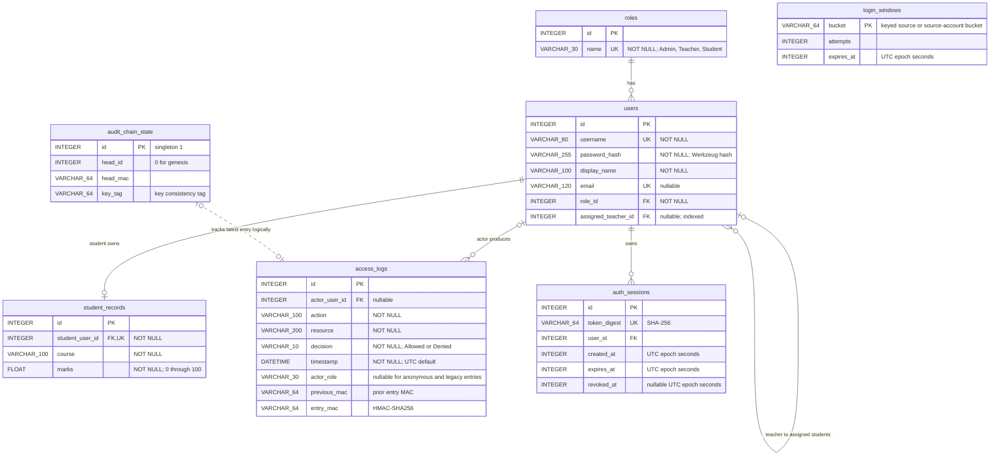

# Database schema — version 1 (Phase 7.1)

All seven tables live in the canonical `instance/securerole.db`.
Version 1 retains the original four application tables and adds three
security tables. Use [unified setup](../../README.md#database) to initialize
or upgrade the database and verify its integrity.

The final ERD is also available as [editable Mermaid](database-erd.mmd)
and a [scalable SVG export](database-erd.svg).

## Columns and constraints

All `id` columns are integer primary keys generated by SQLite.

| Table | Column | SQL type | Null allowed | Constraint / default |
| --- | --- | --- | --- | --- |
| roles | id | INTEGER | No | Primary key |
| roles | name | VARCHAR(30) | No | Unique; CHECK Admin, Teacher or Student |
| users | id | INTEGER | No | Primary key |
| users | username | VARCHAR(80) | No | Unique |
| users | password_hash | VARCHAR(255) | No | Set with Werkzeug `generate_password_hash` |
| users | display_name | VARCHAR(100) | No | Required |
| users | email | VARCHAR(120) | Yes | Unique when non-NULL; multiple NULLs allowed |
| users | role_id | INTEGER | No | Foreign key → roles.id |
| users | assigned_teacher_id | INTEGER | Yes | Foreign key → users.id; index |
| student_records | id | INTEGER | No | Primary key |
| student_records | student_user_id | INTEGER | No | Unique foreign key → users.id |
| student_records | course | VARCHAR(100) | No | Required |
| student_records | marks | FLOAT | No | CHECK marks >= 0 AND marks <= 100 |
| access_logs | id | INTEGER | No | Primary key |
| access_logs | actor_user_id | INTEGER | Yes | Foreign key → users.id |
| access_logs | action | VARCHAR(100) | No | Required |
| access_logs | resource | VARCHAR(200) | No | Required |
| access_logs | decision | VARCHAR(10) | No | CHECK Allowed or Denied |
| access_logs | timestamp | DATETIME | No | Python default: current UTC datetime |

SQLite does not enforce VARCHAR lengths. NOT NULL requires a
value, but does not itself reject an empty string. Timestamp defaults run through
the ORM; raw SQL inserts must explicitly supply a UTC timestamp.

A session belongs to one account and expires eight hours after creation.
`auth_sessions.user_id` is indexed and cascades on database account deletion.
No account deletion workflow is provided. A session is active only when its
expiry is in the future and `revoked_at` is NULL. `login_windows.expires_at`
is indexed for expiration cleanup. The audit head is a singleton, maintained
by an insert trigger. Its ID and MAC refer to the most recent journal entry
logically. Genesis has ID 0 and a 64-zero MAC.

## Relationships and role consistency

- A role can have zero or many users. Every user references exactly one role.
- A teacher can have zero or many assigned students. A student can have zero or
  one assigned teacher, represented by the self-referencing foreign key.
- Only Student accounts may receive teacher assignments; the referenced account
  must have the Teacher role. Admin and Teacher accounts cannot be assigned.
- Only Student accounts may own academic records. A student can have zero or one
  record; the unique `student_user_id` constraint enforces the upper limit.
- A user can be the actor in many logs. A log can have no actor (for example, an
  anonymous attempt). No logs are generated by seeding.

ORM validation produces friendly errors while SQLite triggers enforce record
ownership, teacher eligibility and dependent role changes. The role catalog
cannot be replaced, edited or deleted. A last-Admin trigger permits a fresh
empty database and prevents demotion or removal of its final Admin after
one has been added. Existing uniqueness and marks CHECK constraints still
apply. Enable foreign-key enforcement on each connection.

Password hash changes revoke the account's sessions in the same transaction.
New audit rows require a valid structural link and role presence for a
named actor. UPDATE and DELETE are rejected, and append-only triggers keep
the head aligned with the last entry. The app verifies HMACs separately. Legacy
rows are signed during migration without inferring historical roles.
