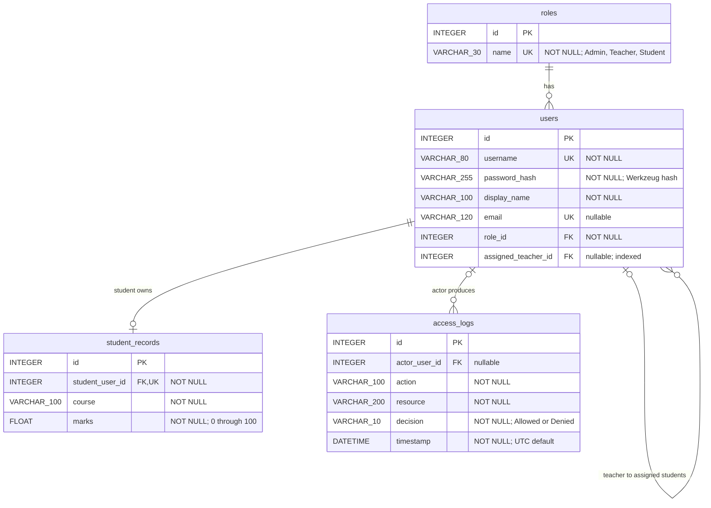

# Final database schema — Phase 3

This is the implemented ERD for SecureRole and the reference for later phases.
No existing Phase 2 ERD artifact was present in the repository to update.

## Columns and constraints

All `id` columns are integer primary keys generated by SQLite.

| Table | Column | SQL type | Null allowed | Constraint / default |
| --- | --- | --- | --- | --- |
| roles | id | INTEGER | No | Primary key |
| roles | name | VARCHAR(30) | No | Unique; CHECK Admin, Teacher or Student |
| users | id | INTEGER | No | Primary key |
| users | username | VARCHAR(80) | No | Unique |
| users | password_hash | VARCHAR(255) | No | Set with Werkzeug `generate_password_hash` |
| users | display_name | VARCHAR(100) | No | Required |
| users | email | VARCHAR(120) | Yes | Unique when non-NULL; multiple NULLs allowed |
| users | role_id | INTEGER | No | Foreign key → roles.id |
| users | assigned_teacher_id | INTEGER | Yes | Foreign key → users.id; index |
| student_records | id | INTEGER | No | Primary key |
| student_records | student_user_id | INTEGER | No | Unique foreign key → users.id |
| student_records | course | VARCHAR(100) | No | Required |
| student_records | marks | FLOAT | No | CHECK marks >= 0 AND marks <= 100 |
| access_logs | id | INTEGER | No | Primary key |
| access_logs | actor_user_id | INTEGER | Yes | Foreign key → users.id |
| access_logs | action | VARCHAR(100) | No | Required |
| access_logs | resource | VARCHAR(200) | No | Required |
| access_logs | decision | VARCHAR(10) | No | CHECK Allowed or Denied |
| access_logs | timestamp | DATETIME | No | Python default: current UTC datetime |

SQLite does not enforce VARCHAR lengths. NOT NULL requires a
value, but does not itself reject an empty string. Timestamp defaults run through
the ORM; raw SQL inserts must explicitly supply a UTC timestamp.

## Relationships and role consistency

- A role can have zero or many users. Every user references exactly one role.
- A teacher can have zero or many assigned students. A student can have zero or
  one assigned teacher, represented by the self-referencing foreign key.
- Only Student accounts may receive teacher assignments; the referenced account
  must have the Teacher role. Admin and Teacher accounts cannot be assigned.
- Only Student accounts may own academic records. A student can have zero or one
  record; the unique `student_user_id` constraint enforces the upper limit.
- A user can be the actor in many logs. A log can have no actor (for example, an
  anonymous attempt). No logs are generated by seeding.

The role conditions are cross-table application invariants enforced by reusable
ORM validation before each flush, including dependent rows when roles change.
Foreign keys, unique/required columns and CHECK constraints are also enforced by
SQLite. Direct/bulk SQL bypasses the ORM role validation. Relationships have no
automatic delete cascades; references must be explicitly resolved before deleting
a role, teacher, record owner or logged actor.
